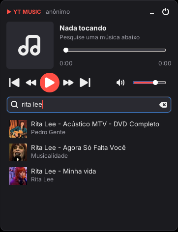

# ytm-popup

Mini player popup do **YouTube Music** para **Linux Mint 22 MATE**, aberto por
atalho de teclado (**Super+M**).



- Capa do álbum, título/artista e barra de progresso clicável
- Anterior · voltar 10s · tocar/pausar · avançar 10s · próxima
- Volume (lembrado entre sessões)
- Busca simples (Enter) — também aceita colar um link do YouTube
- Fila automática ("rádio") a partir da música escolhida
- **Sem digitar login:** se você estiver logado no YouTube no **Firefox**, o
  player usa essa sessão automaticamente (YouTube Premium: áudio em qualidade
  Premium, recomendações da sua conta). Sem login, funciona em modo anônimo.
  O indicador no topo mostra `● conta do Firefox` ou `anônimo`.

A busca usa [ytmusicapi](https://github.com/sigma67/ytmusicapi) e o áudio toca no
[mpv](https://mpv.io) via [yt-dlp](https://github.com/yt-dlp/yt-dlp).

## Instalação (.deb)

Baixe o `.deb` mais recente em [Releases](../../releases/latest) e instale:

```bash
sudo apt install ./ytm-popup_*_all.deb
```

Depois abra **YT Music Popup** no menu uma vez (ou saia e entre na sessão).
Na primeira execução ele baixa o yt-dlp/ytmusicapi para
`~/.local/share/ytm-popup` (leva ~30 s) e registra o atalho **Super+M**.

## Atalhos

**Globais** (funcionam com o popup fechado):

| Ação | Atalho |
|---|---|
| Abrir / esconder o popup | **Super+M** |
| Próxima / anterior | **Super+Alt+→ / ←** |
| Tocar / pausar | **Super+Alt+Espaço** |
| Volume do player + / − | **Super+Alt+↑ / ↓** |
| Teclas de mídia do teclado (▶❚❚ ⏭ ⏮) | funcionam via MPRIS; o player também aparece no applet de som do MATE |

**Com o popup aberto:**

| Ação | Tecla |
|---|---|
| Tocar / pausar | `Espaço` (com a busca vazia) |
| Próxima / anterior | `Ctrl+→` / `Ctrl+←` |
| Voltar / avançar 10 s | `Alt+←` / `Alt+→` |
| Volume + / − | `Ctrl+↑` / `Ctrl+↓` |
| Esconder | `Esc` ou clicar fora |
| Encerrar o player | botão ⏻ |

Os atalhos globais podem ser trocados em *Centro de Controle → Atalhos de
teclado → Atalhos personalizados*, ou pelo terminal:

```bash
ytm-popup-shortcut --list                # ver atalhos
ytm-popup-shortcut '<Primary><Alt>m'     # trocar o de abrir/fechar (Ctrl+Alt+M)
ytm-popup-shortcut                       # restaurar todos os padrões
```

Comandos (para usar em outros atalhos ou scripts):
`ytm-popup play-pause | next | prev | vol-up | vol-down | quit`

## Login / YouTube Premium

Nada para configurar: faça login normalmente em youtube.com ou
music.youtube.com no Firefox. O ytm-popup lê os cookies do YouTube do perfil
padrão do Firefox ao abrir (e a cada 3 horas), copia **apenas** os cookies do
YouTube/Google para um arquivo privado em `$XDG_RUNTIME_DIR` (permissão 600,
apagado ao desligar) e os usa no yt-dlp e no ytmusicapi. Nenhuma senha é
lida ou digitada.

Para usar outro navegador, ou desligar, edite `~/.config/ytm-popup/config.json`:

```json
{ "cookies_from_browser": "auto" }
```

`"auto"` (Firefox, padrão) · `"chrome"` · `"chromium"` · `"brave"` · `"none"` (sempre anônimo).
Reinicie o player (⏻ e Super+M) depois de mudar.

Outras opções no mesmo arquivo: `volume`, `hide_on_focus_out` (true/false),
`language` (padrão `"pt"`).

## Problemas

- **Não toca / pula faixas:** o motivo exato fica em
  `~/.local/share/ytm-popup/player.log`. O yt-dlp é atualizado sozinho toda
  semana; para forçar: encerre o player (⏻), rode `ytm-popup --reset` e abra
  de novo. Se a sessão do Firefox falhar, o player toca sem a conta e avisa.
- **Depois de atualizar o .deb:** encerre o player (⏻) e abra de novo.
- **Atalho não funciona:** confira em *Centro de Controle → Atalhos de teclado*
  se outra ação usa a mesma tecla.

## Compilar o .deb

```bash
packaging/build-deb.sh          # gera dist/ytm-popup_<versão>_all.deb
```

Cada tag `v*` enviada ao GitHub gera o `.deb` e publica a Release automaticamente.

## Desinstalar

```bash
ytm-popup-shortcut --remove
```
```bash
sudo apt remove ytm-popup && rm -rf ~/.local/share/ytm-popup ~/.config/ytm-popup
```

## Licença

MIT
